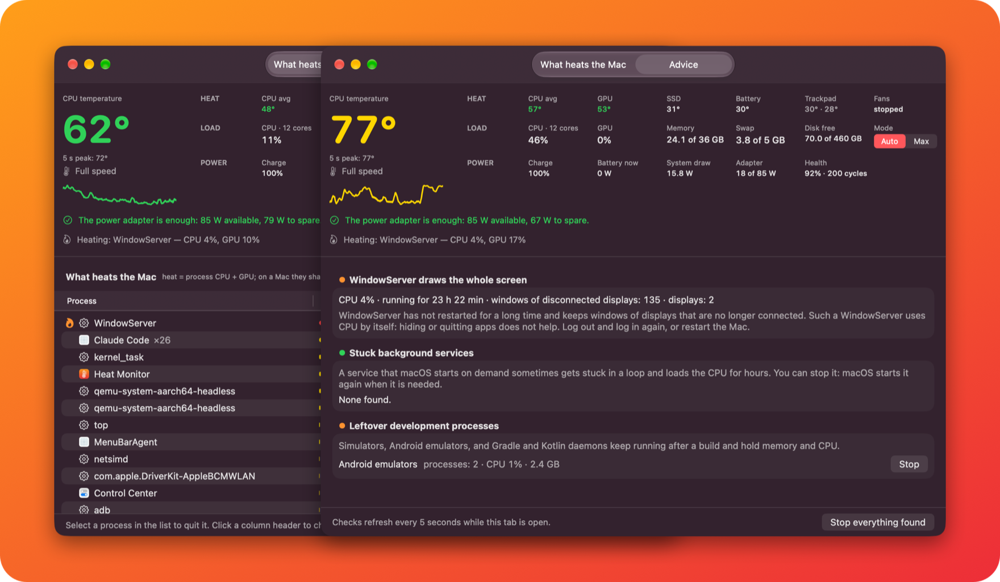
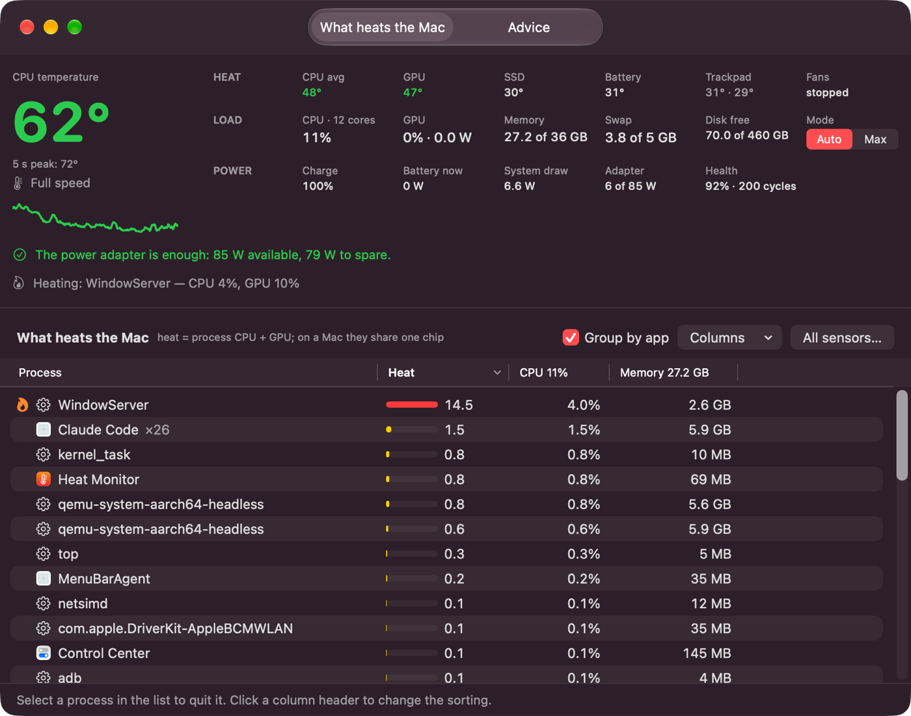
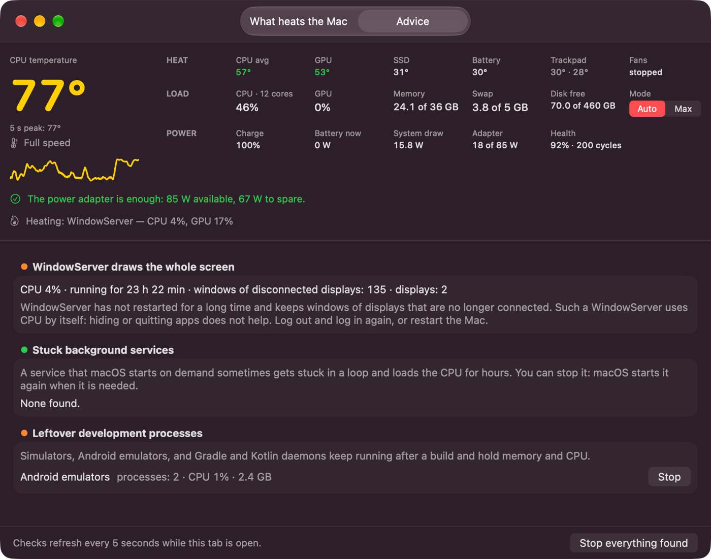
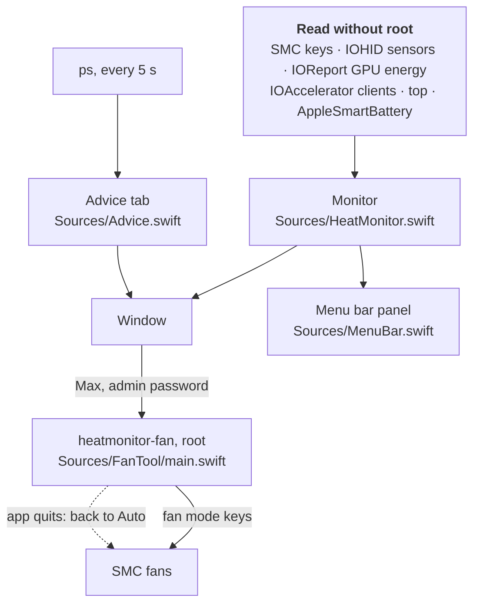

<div align="center">
  
  <h1>Heat Monitor</h1>
  <p><b>A macOS menu bar app that shows how hot your Mac is and what heats it.</b></p>
  <p>English · <a href="README.ru.md">Русский</a></p>

  <a href="https://github.com/Disspear574/HeatMonitor/releases/latest/download/HeatMonitor.dmg">
    
  </a>
  <br><br>
  <a href="https://github.com/Disspear574/HeatMonitor/releases/latest"></a>
  
  
  
  <a href="LICENSE"></a>
</div>

<br>

<p align="center">
  
</p>

Click the thermometer in the menu bar, look, click away. Heat Monitor reads the sensors only
while you look, makes no network requests, and needs no administrator password to read them.

## Features

- **Menu bar.** The thermometer opens a compact panel: CPU temperature with a chart, sensors,
  load, memory and swap, power, the five hottest apps and the fan switch. See [Menu bar](#menu-bar).
- **CPU temperature.** The hottest core, averaged over 5 seconds, with the 5-second peak and a
  3-minute chart.
- **Heat sensors.** Average CPU core, GPU, SSD, battery, trackpad and fan speed.
- **What heats the Mac.** Apps or single processes sorted by heat: their share of CPU plus GPU.
  Right-click a row to search the web for it, show it in Finder or quit it.
- **Power.** Charge, battery flow, system draw and the adapter's input against what it can give.
  One line says whether the adapter keeps up or the battery drains while plugged in.
- **Fans.** Switch between Auto and Max. See [Fans](#fans).
- **Advice.** Finds a WindowServer that has not restarted for days, background services stuck in
  a loop, and simulators, emulators and Gradle daemons left after a build.
- **All sensors.** A raw list of every temperature sensor with a button that copies them all.
- **English and Russian.** The interface follows the system language.

<details>
<summary>Full-size screenshots</summary>
<br>


</details>

## Menu bar

Heat Monitor starts in the menu bar, without a window or a Dock icon. Left click opens the
panel; right click offers Open Heat Monitor and Quit. Closing the window keeps the app running.

Settings (the gear in the panel, or ⌘,):

| Setting | Choices | Default |
|---|---|---|
| Show in Dock | on, off | off |
| Menu bar | Icon only, Icon and values | Icon only |
| Values | CPU temperature, GPU temperature, fan speed, Mac power draw, CPU load | CPU temperature |
| Panel | Temperature and chart, sensors, load, power, what heats the Mac, fans | all on |

## Install

1. Download [HeatMonitor.dmg](https://github.com/Disspear574/HeatMonitor/releases/latest/download/HeatMonitor.dmg).
2. Open it and drag **Heat Monitor** to **Applications**.

> [!IMPORTANT]
> The app is signed ad hoc and not notarized by Apple, so macOS blocks the first launch.
> Open **System Settings → Privacy & Security**, find the message about Heat Monitor and click
> **Open Anyway**. Or remove the quarantine flag in Terminal:
>
> ```bash
> xattr -dr com.apple.quarantine /Applications/HeatMonitor.app
> ```

**Requirements:** a Mac with Apple Silicon (M1 or later) and macOS 14 or later. Intel Macs are
not supported.

## Fans

The **Auto / Max** switch is the only part of the app that writes to the Mac.

- **Max** asks for an administrator password. The bundled `heatmonitor-fan` tool then sets every
  fan to its maximum speed through the SMC.
- A small root watcher stays with it and returns the fans to Auto when Heat Monitor quits, even
  after a crash.
- Closing the window does not quit, so the fans stay at Max until you choose Quit.
- **Auto** tells the watcher to hand the fans back to macOS, so it needs no password. Only a
  manual mode set by another fan app asks for one.

The app never sets the fans below what macOS asks for. Fanless Macs do not show the switch.

## Advice

The tab runs its checks every 5 seconds, and only while it is open.

| Check | What it looks for | What you can do |
|---|---|---|
| WindowServer | High CPU, days of uptime, offscreen windows left by displays that are gone | Log out and back in, or restart |
| Stuck services | Background services started by macOS that load the CPU for hours | Stop your own; system ones are listed only |
| Leftover dev tools | iOS simulators, Android emulators, Gradle and Kotlin daemons | Stop a group, or everything found after a confirmation |

## How it works



| Reading | Source |
|---|---|
| CPU and GPU temperature | SMC keys `Tp*`, `Te*` (CPU cores) and `Tg*` (GPU) |
| SSD and battery temperature | IOHID temperature sensors |
| System draw, adapter input | SMC keys `PSTR` and `PDTR` |
| GPU watts | IOReport "Energy Model", channel `GPU Energy` (the source `powermetrics` reads) |
| GPU busy time | `IOAccelerator` → `PerformanceStatistics` |
| Per-process GPU | GPU time of each `IOAccelerator` user client |
| Processes | one long-running `top` |
| Battery and adapter | `AppleSmartBattery` and IOKit power sources |
| Advice | `ps` while the tab is open; offscreen windows from `CGWindowListCopyWindowInfo` |

Some of these are private macOS interfaces, so the app cannot be sold in the Mac App Store.

## Good to know

- Core sensors react within a fraction of a second. A short burst of load can raise a core by
  20 °C, especially on a fanless MacBook Air. That is why the big number is a 5-second average.
- GPU busy time is the share of time the GPU has work, not the share of its power. At its
  lowest clock even light work shows 20–40 %; the watts show the real load.
- The trackpad sensors (`Ts0P`, `Ts1P`) sit far from the chip. On a MacBook Air they stay near
  room temperature while the area above the keyboard is hot.
- The adapter rating is the power the Mac and the adapter agreed on, not the number printed on
  the adapter. Over MagSafe it can be lower than the rating.
- Heat Monitor polls processes and sensors only while the panel or the window is open, and for
  60 seconds after you close them. In between it uses no CPU. The live label reads a few SMC
  keys every 5 seconds, about 0.1 % of one core.

## Build

```bash
./scripts/build.sh      # build/HeatMonitor.app
./scripts/make-dmg.sh   # build/HeatMonitor.dmg
./scripts/test.sh       # menu bar logic tests
```

Needs the Xcode command line tools. The version lives in `Resources/Info.plist`.

| Path | What it is |
|---|---|
| `Sources/HeatMonitor.swift` | The window and all readings |
| `Sources/MenuBar.swift` | The menu bar item and its panel |
| `Sources/Settings.swift` | Settings |
| `Sources/MenuLogic.swift` | Label values and polling rules; tests in `Tests/` |
| `Sources/Advice.swift` | The Advice tab |
| `Sources/FanTool/main.swift` | The root-only fan switch |
| `Resources/` | Info.plist, icon, `en.lproj` and `ru.lproj` strings |
| `scripts/` | Build, DMG, icon and README image generators |

## License

[MIT](LICENSE)
