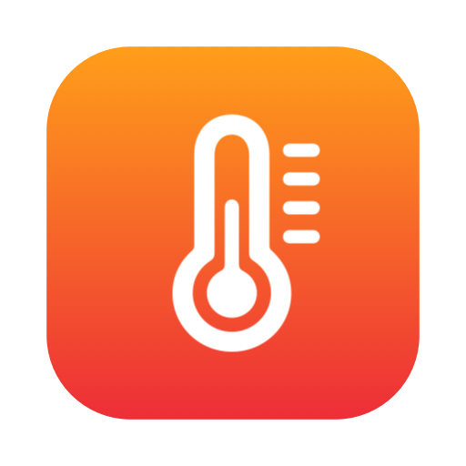
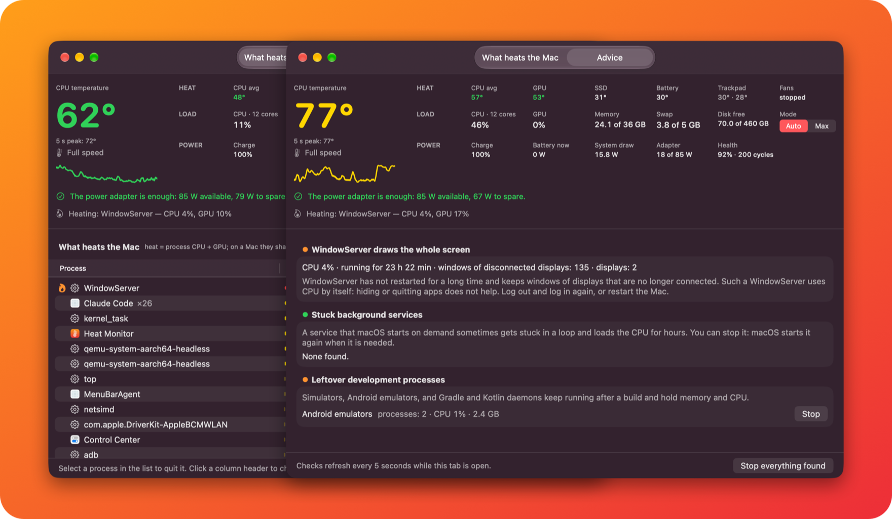
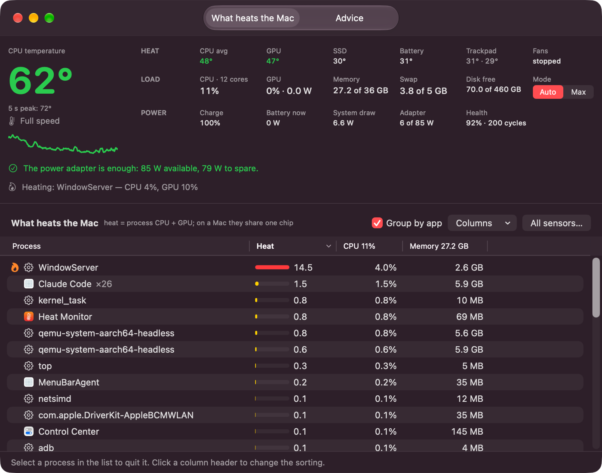
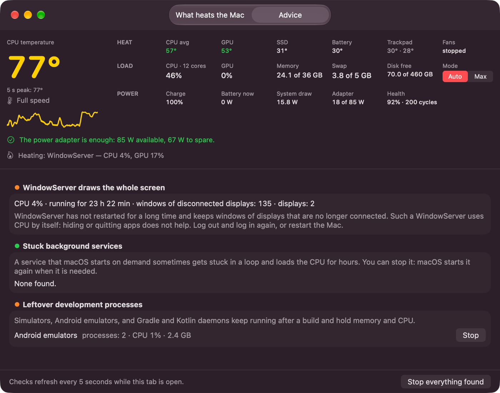
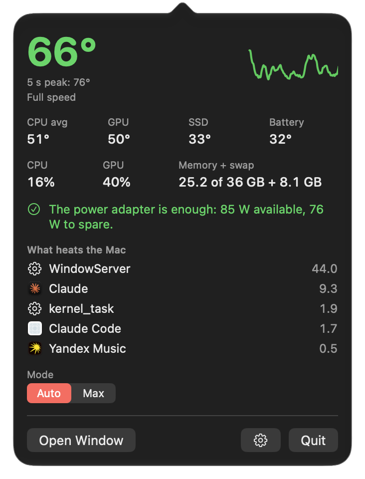
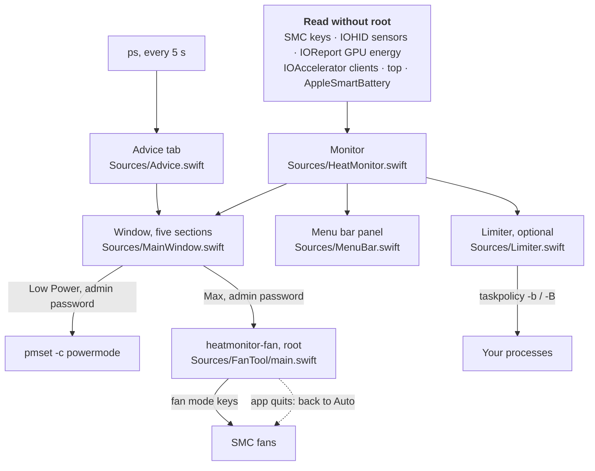

<div align="center">
  
  <h1>Heat Monitor</h1>
  <p><b>A macOS menu bar app that shows how hot your Mac is and what heats it.</b></p>
  <p>English · <a href="README.ru.md">Русский</a></p>

  <a href="https://github.com/Disspear574/HeatMonitor/releases/latest/download/HeatMonitor.dmg">
    
  </a>
  <br><br>
  <a href="https://github.com/Disspear574/HeatMonitor/releases/latest"></a>
  
  
  
  <a href="LICENSE"></a>
</div>

<br>

<p align="center">
  
</p>

Click the thermometer in the menu bar, look, click away. Heat Monitor reads the sensors only
while you look, makes no network requests, and needs no administrator password to read them.

## Features

The window has a sidebar with five sections. Each sidebar row shows one live value: the hottest
app, the CPU temperature, the Mac's draw, the number of advice findings.

- **Overview.** One card answers three questions: how hot the Mac is, what heats it, and whether
  the adapter keeps up. Click a line to open its section. Below it sit the CPU temperature on a
  color scale with the 5-second peak and a 3-minute chart, the hottest apps, and small cards for
  power, load and fans.
- **Processes.** Apps or single processes sorted by heat: their CPU plus GPU watts, shown as a
  share of the Mac's full-load maximum or of the current total. Right-click a row to search the
  web for it, show it in Finder or quit it.
- **Cooling.** The hottest CPU core with its 5-second peak, the core average, GPU, SSD, battery
  and trackpad sensors, and the fan switch. See [Fans](#fans). **All sensors…** lists every
  temperature sensor and copies them all.
- **Power.** The adapter, the Mac and the battery in one row, with the watts flowing between
  them. A verdict says whether the adapter keeps up, and a second line names what limits it.
  See [Power](#power).
- **Advice.** Finds a WindowServer that has not restarted for days, background services stuck in
  a loop, and simulators, emulators and Gradle daemons left after a build. See [Advice](#advice).
- **Menu bar panel.** The same readings in a compact panel. See [Menu bar](#menu-bar).
- **English and Russian.** The interface follows the system language.

<details>
<summary>Full-size screenshots</summary>
<br>




</details>

## Menu bar

Heat Monitor starts in the menu bar, without a window or a Dock icon. Left click opens the
panel; right click offers Open Heat Monitor and Quit. Closing the window keeps the app running.

The panel shows the CPU temperature with a chart, the sensors, load, memory and swap, power, the
five hottest apps and the fan switch. When the adapter falls short, the power block names the
cause too.

<p align="center">
  <br><br>
  
</p>

Settings (the gear in the panel, or ⌘,):

| Setting | Choices | Default |
|---|---|---|
| Show in Dock | on, off | off |
| Menu bar | Icon only, Icon and values | Icon only |
| Values | CPU temperature, GPU temperature, fan speed, Mac power draw, CPU load | CPU temperature |
| Panel | Temperature and chart, sensors, load, power, what heats the Mac, fans | all on |
| Process heat | Share of the Mac's maximum, share of the total load | maximum where measured, otherwise total |
| Limiter | Limit listed processes; when the adapter falls short; when the CPU is hotter than 80–105° | off; both triggers on, 95° |

## Install

1. Download [HeatMonitor.dmg](https://github.com/Disspear574/HeatMonitor/releases/latest/download/HeatMonitor.dmg).
2. Open it and drag **Heat Monitor** to **Applications**.

> [!IMPORTANT]
> The app is signed ad hoc and not notarized by Apple, so macOS blocks the first launch.
> Open **System Settings → Privacy & Security**, find the message about Heat Monitor and click
> **Open Anyway**. Or remove the quarantine flag in Terminal:
>
> ```bash
> xattr -dr com.apple.quarantine /Applications/HeatMonitor.app
> ```

**Requirements:** a Mac with Apple Silicon (M1 or later) and macOS 14 or later. Intel Macs are
not supported.

## Power

The flow card puts the adapter, the Mac and the battery in one row: what the adapter gives
against what it agreed to give, what the Mac draws, and how many watts go into the battery or
come out of it. The verdict above it says whether the adapter is enough, at its limit, or not
enough, and a bar shows the adapter's load. Below the flow you see the power source, the USB-C
devices and the battery's health, cycles and temperature.

When the adapter delivers less than you expect, a line under the flow names the cause:

| Cause | How Heat Monitor knows | What it says |
|---|---|---|
| The cable | The USB-C cable's e-marker reports less than 240 W, and the Mac gets at least 90 % of that | The cable's rating, and that more power needs a 240 W (EPR) USB-C cable |
| The cable, no e-marker data | The adapter's name carries its rating, and the Mac got less than 90 % of it | The adapter's rating against what the Mac got |
| A weak adapter | Neither of the above | The adapter gives N W, too weak for this load |

A cable limit shows at any load. A weak adapter shows only while the battery covers the gap.
Over MagSafe the cable is Apple's, so Heat Monitor never blames it.

**Low Power on the adapter.** The Energy mode card shows the mode macOS uses on the adapter.
While the adapter falls short, it suggests turning on Low Power, with the cause under the
suggestion. The button runs `pmset -c powermode 1`, and macOS asks for the administrator
password; Heat Monitor never sees or stores it. **Back to Automatic** undoes it.

**Limiter** (Settings, off by default). When the adapter falls short or the CPU passes the
threshold for a set time (1–15 min, 3 by default), Heat Monitor moves your processes that match
the list to background priority with `taskpolicy -b`. They run slower and never stop. Once the
load is gone, the same wait passes and the priority comes back. A notification tells you each
time. The default list holds simulators, emulators, Gradle and Kotlin daemons, `swift-frontend`
and `xcodebuild`, one pattern per line.

## Fans

The **Auto / Max** switch is the only part of the app that writes to the SMC.

- **Max** asks for an administrator password. The bundled `heatmonitor-fan` tool then sets every
  fan to its maximum speed through the SMC.
- A small root watcher stays with it and returns the fans to Auto when Heat Monitor quits, even
  after a crash.
- Closing the window does not quit, so the fans stay at Max until you choose Quit.
- **Auto** tells the watcher to hand the fans back to macOS, so it needs no password. Only a
  manual mode set by another fan app asks for one.

The app never sets the fans below what macOS asks for. Fanless Macs do not show the switch.

## Advice

The section runs its checks every 5 seconds while you look at it. With the window open, the
number of findings in the sidebar updates once a minute.

| Check | What it looks for | What you can do |
|---|---|---|
| WindowServer | High CPU, days of uptime, offscreen windows left by displays that are gone | Log out and back in, or restart |
| Stuck services | Background services started by macOS that load the CPU for hours | Stop your own; system ones are listed only |
| Leftover dev tools | iOS simulators, Android emulators, Gradle and Kotlin daemons | Stop a group, or everything found after a confirmation |

## How it works



| Reading | Source |
|---|---|
| CPU and GPU temperature | SMC keys `Tp*`, `Te*` (CPU cores) and `Tg*` (GPU) |
| SSD and battery temperature | IOHID temperature sensors |
| System draw, adapter input | SMC keys `PSTR` and `PDTR` |
| GPU watts | IOReport "Energy Model", channel `GPU Energy` (the source `powermetrics` reads) |
| GPU busy time | `IOAccelerator` → `PerformanceStatistics` |
| Watts per app (CPU, GPU, Neural Engine) | the kernel's resource coalitions: `coalition_info_resource_usage`, including processes that already exited |
| Per-process CPU watts | `proc_pid_rusage` → `ri_energy_nj` for your own processes; the rest of an app's energy is split by CPU time |
| Per-process GPU | the app's GPU energy, split by the GPU time of each `IOAccelerator` user client |
| Processes | one long-running `top` |
| Battery and adapter | `AppleSmartBattery` and IOKit power sources |
| USB-C cable rating | the cable's e-marker (USB PD Discover Identity, `SOP'` under the port's `IOPort`) |
| Energy mode on the adapter | `pmset -g custom` |
| Advice | `ps` while the tab is open; offscreen windows from `CGWindowListCopyWindowInfo` |

Some of these are private macOS interfaces, so the app cannot be sold in the Mac App Store.

## Good to know

- Core sensors react within a fraction of a second. A short burst of load can raise a core by
  20 °C, especially on a fanless MacBook Air. That is why the big number is a 5-second average.
- GPU busy time is the share of time the GPU has work, not the share of its power. At its
  lowest clock even light work shows 20–40 %; the watts show the real load.
- Process heat is energy, not busy time. macOS keeps the CPU, GPU and Neural Engine energy of
  each app with its helpers and child processes, also after a child exits, so a build made of
  many short compiler runs still counts. Your own processes show their own CPU energy; the rest
  of an app's energy is split between its processes by CPU time and marked with ≈. The full-load
  maximum is measured per chip (Apple M5 Pro: 73 W with every CPU and GPU core busy); other chips
  show shares of the total load by default.
- The trackpad sensors (`Ts0P`, `Ts1P`) sit far from the chip. On a MacBook Air they stay near
  room temperature while the area above the keyboard is hot.
- The adapter rating is the power the Mac and the adapter agreed on, not the number printed on
  the adapter. Over MagSafe it can be lower than the rating.
- Heat Monitor polls processes and sensors only while the panel or the window is open, and for
  60 seconds after you close them. In between it uses no CPU. The live label reads a few SMC
  keys every 5 seconds, about 0.1 % of one core. The limiter, when you turn it on, reads the CPU
  temperature and the power every 30 seconds.

## Build

```bash
./scripts/build.sh      # build/HeatMonitor.app
./scripts/make-dmg.sh   # build/HeatMonitor.dmg
./scripts/test.sh       # logic tests: menu bar, power advice, limiter
```

Needs the Xcode command line tools. The version lives in `Resources/Info.plist`.

| Path | What it is |
|---|---|
| `Sources/HeatMonitor.swift` | All readings, the fan switch and the sensors window |
| `Sources/MainWindow.swift` | The window and its sidebar |
| `Sources/Overview.swift`, `Processes.swift`, `Cooling.swift`, `Power.swift` | The window sections |
| `Sources/Advice.swift` | The Advice section |
| `Sources/PowerAdvice.swift`, `EnergyMode.swift` | What limits the adapter power, Low Power on the adapter |
| `Sources/Limiter.swift`, `LimiterLogic.swift` | The optional limiter |
| `Sources/MenuBar.swift` | The menu bar item and its panel |
| `Sources/Settings.swift` | Settings |
| `Sources/MenuLogic.swift` | Label values and polling rules; tests in `Tests/` |
| `Sources/FanTool/main.swift` | The root-only fan switch |
| `Resources/` | Info.plist, icon, `en.lproj` and `ru.lproj` strings |
| `scripts/` | Build, DMG, icon and README image generators |

## License

[MIT](LICENSE)
