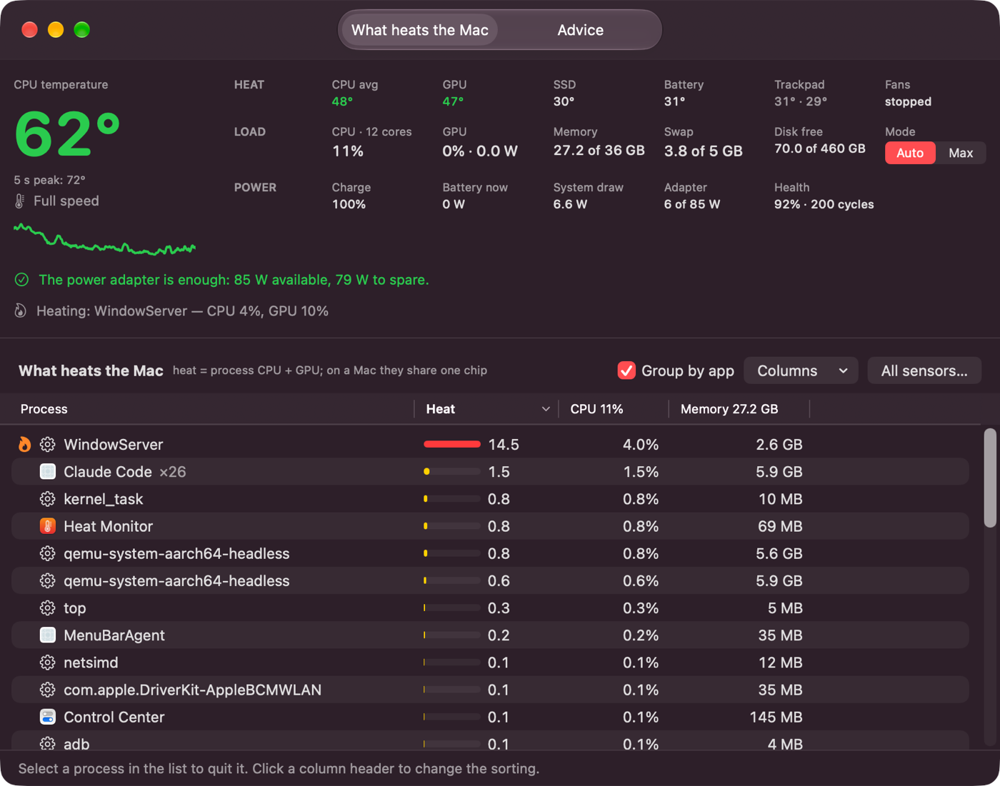
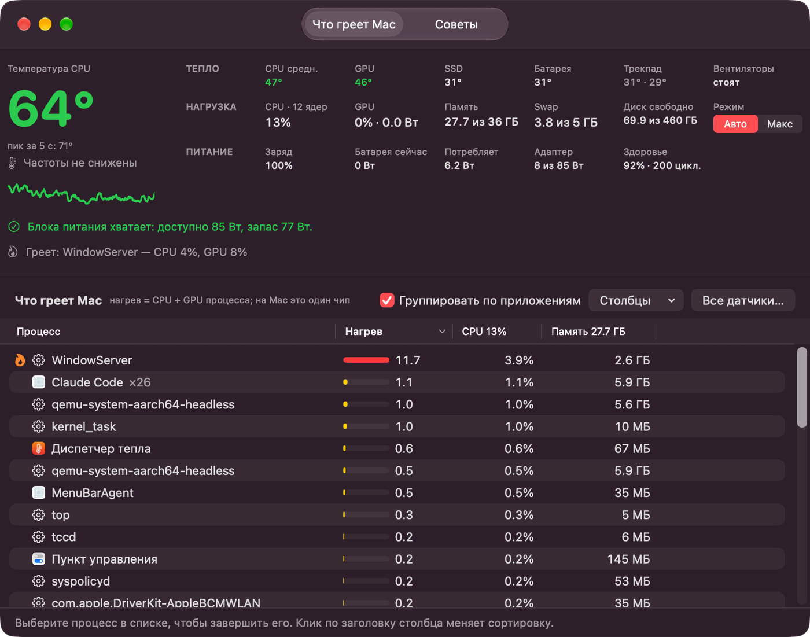

# Heat Monitor

A small macOS window that shows how hot your Mac is and what heats it: CPU and GPU temperature,
which apps load the chip, memory, fans, and whether the power adapter keeps up with the load.
Open it, look, close it. No background service, no network access; reading needs no root.



[Русская версия ниже](#по-русски)

## What it shows

- **CPU temperature**: the hottest core, averaged over 5 seconds, and the 5-second peak.
  A 3-minute chart.
- **Heat**: average CPU core, GPU, SSD, battery, trackpad, fans.
  Fanless Macs show "none".
- **Fan mode**: Auto or Max. See [Fans](#fans).
- **Load**: CPU, GPU busy time and GPU watts, memory, swap, free disk space.
- **Power**: battery charge, battery flow, system draw, adapter input against its rating,
  battery health and cycles. One line says whether the adapter is enough or the battery
  is draining while plugged in.
- **What heats the Mac**: processes or apps sorted by heat (CPU share + GPU share). Right-click
  a row to search the web for it, show it in Finder or quit it.
- **All sensors**: a raw list of every temperature sensor, with a button that copies a report.
- **Advice**: checks that run only while the tab is open. WindowServer that has not restarted
  for days and keeps windows of disconnected displays; background services stuck in a loop;
  simulators, Android emulators and Gradle or Kotlin daemons left after a build. Your own stuck
  services and dev tools can be stopped from the tab.


## Install

1. Download `HeatMonitor-<version>.dmg` from [Releases](../../releases).
2. Open it and drag **Heat Monitor** to **Applications**.
3. The app is not notarized by Apple, so the first launch is blocked. Open
   **System Settings → Privacy & Security**, find the message about Heat Monitor and click
   **Open Anyway**.

Or remove the quarantine flag in Terminal:

```bash
xattr -dr com.apple.quarantine "/Applications/HeatMonitor.app"
```

Requirements: a Mac with Apple Silicon (M1 or later), macOS 14 or later. Intel Macs are not
supported. The interface is in English and Russian and follows the system language.

## Where the numbers come from

| Reading | Source |
|---|---|
| CPU and GPU temperature | SMC keys `Tp*`, `Te*` (CPU cores) and `Tg*` (GPU) |
| SSD and battery temperature | IOHID temperature sensors |
| System draw, adapter input | SMC keys `PSTR` and `PDTR` |
| GPU watts | IOReport "Energy Model", channel `GPU Energy` (the source `powermetrics` reads) |
| GPU busy time | `IOAccelerator` → `PerformanceStatistics` |
| Per-process GPU | GPU time of each `IOAccelerator` user client |
| Processes | one long-running `top` |
| Battery and adapter | `AppleSmartBattery` and IOKit power sources |
| Advice | `ps` every 5 seconds while the tab is open; offscreen windows from `CGWindowListCopyWindowInfo` |

All of these are readable without root. Some are private macOS interfaces, so the app cannot be
sold in the Mac App Store.

## Good to know

- Core sensors react within a fraction of a second. A short burst of load can raise a core by
  20 °C, especially on a fanless MacBook Air. That is why the big number is a 5-second average.
- GPU busy time is the share of time the GPU has work, not the share of its power. At its
  lowest clock even light work shows 20–40 %; the watts show the real load.
- The trackpad sensors (`Ts0P`, `Ts1P`) sit far from the chip. On a MacBook Air they stay near
  room temperature while the area above the keyboard is hot; the app has no reading for that area.
- The app itself uses about 5–15 % of one core while its window is visible and pauses when the
  window is hidden.

## Fans

The **Auto / Max** switch is the only part that writes to the Mac. Max asks for an administrator
password, then the bundled `heatmonitor-fan` tool sets every fan to its maximum speed through the
SMC. A small root watcher stays with it and returns the fans to Auto when Heat Monitor quits,
even after a crash. Auto tells that watcher to hand the fans back to macOS, so it needs no
password; only a manual mode set by another fan app asks for one. The app never sets fans below what macOS
asks for. Fanless Macs do not show the switch.

## Build

```bash
./scripts/build.sh      # build/HeatMonitor.app
./scripts/make-dmg.sh   # build/HeatMonitor-<version>.dmg
```

Needs Xcode command line tools. The version lives in `Resources/Info.plist`. The app is signed
ad-hoc.

- `Sources/HeatMonitor.swift`: the app window and readings.
- `Sources/Advice.swift`: the Advice tab.
- `Sources/FanTool/main.swift`: the root-only fan switch.
- `Resources/`: Info.plist, icon, `en.lproj` and `ru.lproj` strings.
- `scripts/`: build, icon and DMG background generators.

## License

[MIT](LICENSE)

---

## По-русски

Небольшое окно для macOS. Оно показывает, насколько горячий Mac и что его греет: температуру CPU
и GPU, какие приложения нагружают чип, память, вентиляторы и хватает ли блока питания.
Для чтения права администратора не нужны, сеть не используется. Переключатель вентиляторов
«Авто / Макс» спрашивает пароль администратора; при выходе из приложения вентиляторы
возвращаются в «Авто». Вкладка «Советы» находит WindowServer, который давно не перезапускался,
зависшие фоновые службы и забытые симуляторы, эмуляторы и демоны Gradle.



**Установка.** Скачайте DMG со страницы [Releases](../../releases) и перетащите приложение в
«Программы». Приложение не нотаризовано Apple, поэтому первый запуск блокируется. Откройте
«Системные настройки → Конфиденциальность и безопасность» и нажмите «Всё равно открыть».
Нужен Mac на Apple Silicon и macOS 14 или новее. Язык интерфейса — как у системы.
