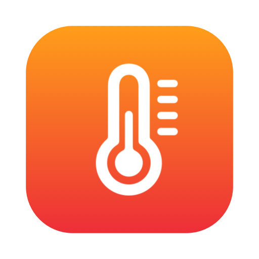
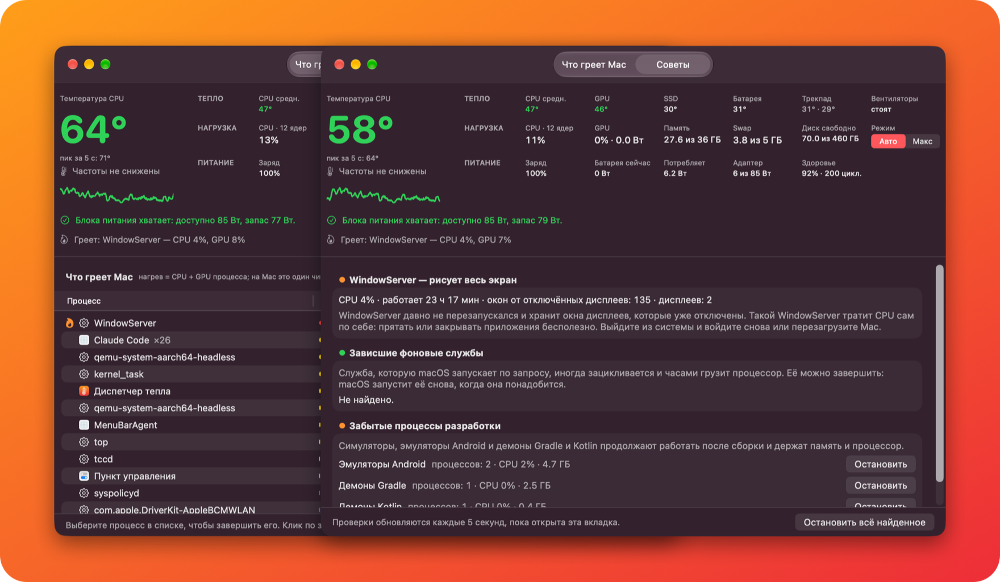
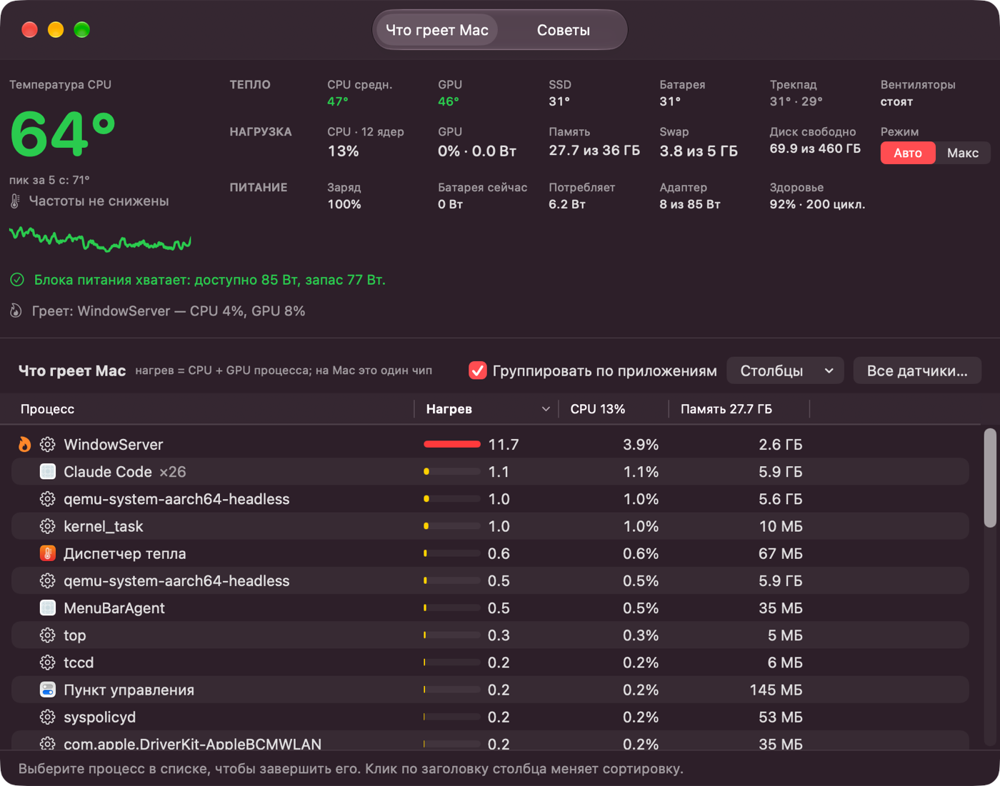
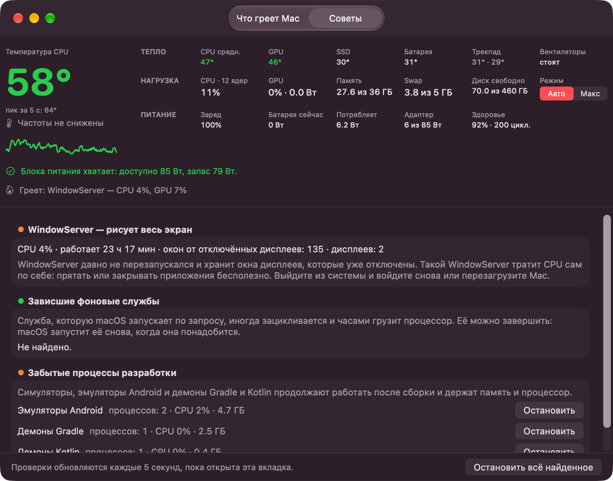
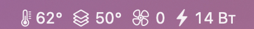
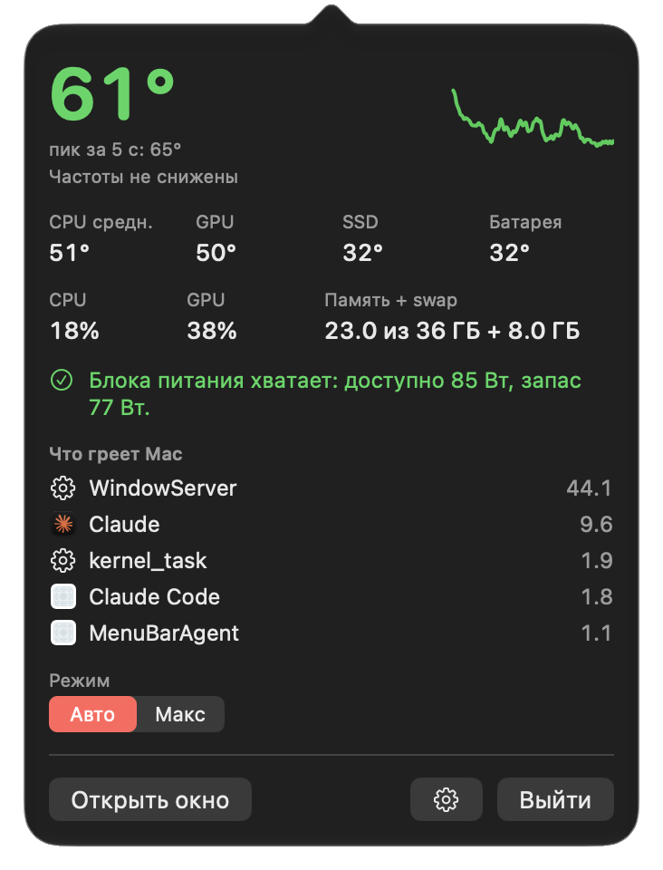
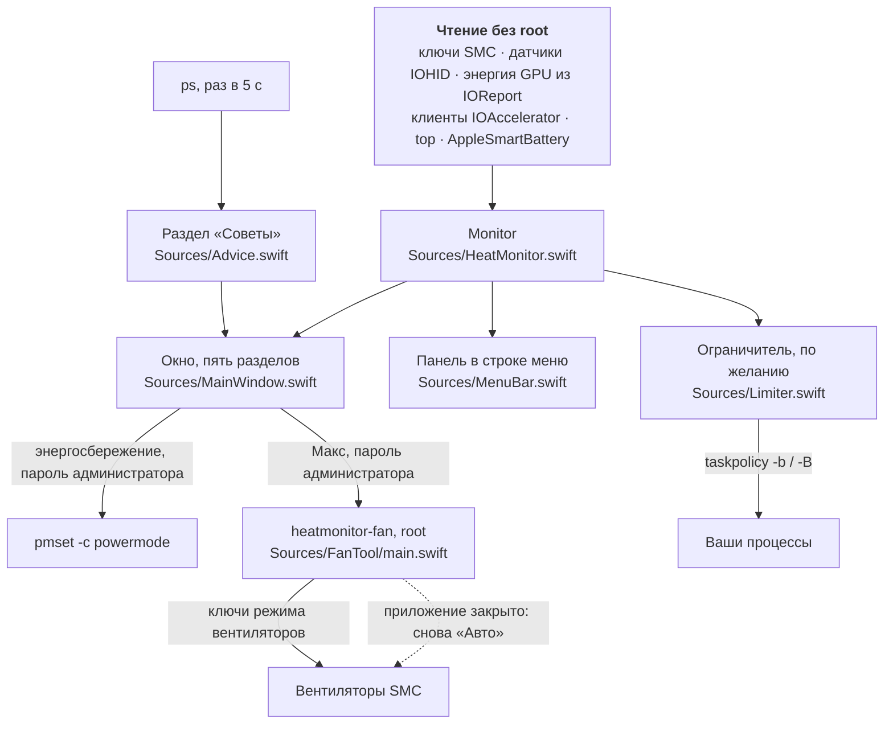

<div align="center">
  
  <h1>Heat Monitor</h1>
  <p><b>Приложение в строке меню macOS: насколько горячий Mac и что его греет.</b></p>
  <p><a href="README.md">English</a> · Русский</p>

  <a href="https://github.com/Disspear574/HeatMonitor/releases/latest/download/HeatMonitor.dmg">
    
  </a>
  <br><br>
  <a href="https://github.com/Disspear574/HeatMonitor/releases/latest"></a>
  
  
  
  <a href="LICENSE"></a>
</div>

<br>

<p align="center">
  
</p>

Нажмите термометр в строке меню, посмотрите, кликните мимо. Heat Monitor читает датчики, только
пока вы смотрите, в сеть не ходит, а для чтения датчиков пароль администратора не нужен.

## Возможности

В окне боковая панель с пятью разделами. В каждой строке панели одно живое значение: самое
горячее приложение, температура CPU, потребление Mac, число находок в советах.

- **Обзор.** Одна карточка отвечает на три вопроса: насколько горячо, что греет и хватает ли
  адаптера. Клик по строке открывает её раздел. Ниже — температура CPU на цветной шкале с пиком за
  5 секунд и графиком за 3 минуты, самые горячие приложения и маленькие карточки питания, нагрузки
  и вентиляторов.
- **Процессы.** Приложения или отдельные процессы по нагреву: ватты CPU плюс GPU, в процентах
  от максимума Mac под полной нагрузкой или от текущей общей нагрузки.
  Правый клик по строке — поиск в интернете, показ в Finder или завершение.
- **Охлаждение.** Самое горячее ядро CPU с пиком за 5 секунд, среднее по ядрам, датчики GPU, SSD,
  батареи и трекпада и переключатель вентиляторов (см. [Вентиляторы](#вентиляторы)).
  **Все датчики…** показывает полный список температурных датчиков и копирует его.
- **Питание.** Адаптер, Mac и батарея в одну строку и ватты между ними. Вердикт говорит, хватает
  ли адаптера, вторая строка называет, что его ограничивает. Подробнее — в разделе
  [Питание](#питание).
- **Советы.** Находит WindowServer, который несколько дней не перезапускался, зациклившиеся
  фоновые службы и забытые после сборки симуляторы, эмуляторы и демоны Gradle. Подробнее — в
  разделе [Советы](#советы).
- **Панель в строке меню.** Те же показания в компактном виде. Подробнее — в разделе
  [Строка меню](#строка-меню).
- **Русский и английский.** Язык интерфейса — как у системы.

<details>
<summary>Скриншоты в полный размер</summary>
<br>




</details>

## Строка меню

Heat Monitor запускается в строке меню, без окна и без значка в Dock. Левый клик открывает
панель, правый — меню «Открыть Диспетчер тепла» и «Выйти». Закрытое окно приложение не завершает.

В панели температура CPU с графиком, датчики, нагрузка, память и своп, питание, пять самых
горячих приложений и вентиляторы. Когда адаптера не хватает, блок питания называет и причину.

<p align="center">
  <br><br>
  
</p>

Настройки (шестерёнка в панели или ⌘,):

| Настройка | Варианты | По умолчанию |
|---|---|---|
| Показывать в Dock | вкл., выкл. | выкл. |
| Строка меню | Только значок, Значок и значения | Только значок |
| Значения | Температура CPU, температура GPU, обороты вентиляторов, потребление Mac, загрузка CPU | Температура CPU |
| Панель | Температура и график, датчики, нагрузка, питание, что греет Mac, вентиляторы | все включены |
| Нагрев процессов | Доля от максимума Mac, доля от общей нагрузки | от максимума, где он замерен, иначе от общей |
| Ограничитель | Ограничивать процессы из списка; когда не хватает питания от адаптера; когда CPU горячее 80–105° | выкл.; оба условия вкл., 95° |

## Установка

1. Скачайте [HeatMonitor.dmg](https://github.com/Disspear574/HeatMonitor/releases/latest/download/HeatMonitor.dmg).
2. Откройте его и перетащите **Heat Monitor** в **Программы**.

> [!IMPORTANT]
> Приложение подписано ad hoc и не нотаризовано Apple, поэтому macOS блокирует первый запуск.
> Откройте **Системные настройки → Конфиденциальность и безопасность**, найдите сообщение о
> Heat Monitor и нажмите **Всё равно открыть**. Или снимите карантин в Терминале:
>
> ```bash
> xattr -dr com.apple.quarantine /Applications/HeatMonitor.app
> ```

**Требования:** Mac на Apple Silicon (M1 и новее) и macOS 14 или новее. Mac на Intel не
поддерживаются.

## Питание

Карточка потока ставит адаптер, Mac и батарею в одну строку: сколько адаптер отдаёт из
согласованного, сколько берёт Mac и сколько ватт идёт в батарею или из неё. Вердикт над ней
говорит, хватает ли адаптера, на пределе ли он или его не хватает; полоса показывает загрузку
адаптера. Ниже — источник питания, устройства USB-C и здоровье, циклы и температура батареи.

Когда адаптер отдаёт меньше ожидаемого, строка под потоком называет причину:

| Причина | Как Heat Monitor это узнаёт | Что пишет |
|---|---|---|
| Кабель | E-marker кабеля USB-C сообщает меньше 240 Вт, и Mac получает не меньше 90 % от этого | Номинал кабеля и что для большей мощности нужен кабель USB-C 240 Вт (EPR) |
| Кабель, данных e-marker нет | В названии адаптера есть его мощность, а Mac получил меньше 90 % от неё | Мощность адаптера и сколько получил Mac |
| Слабый адаптер | Ни то, ни другое | Адаптер даёт N Вт, для такой нагрузки слабый |

Ограничение кабелем показывается при любой нагрузке. Слабый адаптер — только пока батарея
добирает недостающее. Через MagSafe кабель всегда от Apple, его Heat Monitor не винит.

**Энергосбережение от адаптера.** Карточка «Режим энергопотребления от адаптера» показывает режим,
который macOS использует от сети. Пока адаптера не хватает, она предлагает включить
энергосбережение и пишет причину под предложением. Кнопка выполняет `pmset -c powermode 1`, macOS
спрашивает пароль администратора; Heat Monitor его не видит и не хранит. **Вернуть
«Автоматически»** отменяет это.

**Ограничитель** (Настройки, по умолчанию выключен). Когда адаптера не хватает или CPU горячее
порога дольше заданного времени (1–15 мин, по умолчанию 3), Heat Monitor переводит ваши
процессы из списка в фоновый приоритет через `taskpolicy -b`. Они работают медленнее, но не
останавливаются. Когда нагрузка уходит, после того же ожидания приоритет возвращается. Каждый раз
приходит уведомление. В списке по умолчанию симуляторы, эмуляторы, демоны Gradle и Kotlin,
`swift-frontend` и `xcodebuild`, по одной строке на шаблон.

## Вентиляторы

Переключатель **Авто / Макс** — единственное, что приложение пишет в SMC.

- **Макс** спрашивает пароль администратора. Затем встроенная утилита `heatmonitor-fan`
  выставляет всем вентиляторам максимальные обороты через SMC.
- Рядом остаётся небольшой сторож с правами root. Он возвращает «Авто», когда Heat Monitor
  закрывается, даже после сбоя.
- Закрытое окно приложение не завершает, поэтому вентиляторы остаются на «Макс», пока вы не
  выберете «Выйти».
- **Авто** просит сторожа вернуть вентиляторы macOS, поэтому пароль не нужен. Пароль
  спрашивается, только если ручной режим включила другая программа для вентиляторов.

Приложение никогда не опускает обороты ниже тех, что просит macOS. На Mac без вентиляторов
переключателя нет.

## Советы

Раздел проверяет систему каждые 5 секунд, пока вы на него смотрите. Пока окно открыто, число
находок в боковой панели обновляется раз в минуту.

| Проверка | Что ищет | Что можно сделать |
|---|---|---|
| WindowServer | Высокая нагрузка, дни без перезапуска, невидимые окна от отключённых дисплеев | Выйти из системы и войти снова или перезагрузить Mac |
| Зависшие службы | Фоновые службы macOS, которые часами грузят процессор | Завершить свои; системные только показаны |
| Забытые процессы разработки | Симуляторы iOS, эмуляторы Android, демоны Gradle и Kotlin | Остановить группу или всё найденное после подтверждения |

## Как это работает



| Показание | Источник |
|---|---|
| Температура CPU и GPU | Ключи SMC `Tp*`, `Te*` (ядра CPU) и `Tg*` (GPU) |
| Температура SSD и батареи | Температурные датчики IOHID |
| Потребление Mac, мощность адаптера | Ключи SMC `PSTR` и `PDTR` |
| Ватты GPU | IOReport «Energy Model», канал `GPU Energy` (его же читает `powermetrics`) |
| Загрузка GPU | `IOAccelerator` → `PerformanceStatistics` |
| Ватты по приложениям (CPU, GPU, Neural Engine) | Коалиции ресурсов ядра: `coalition_info_resource_usage`, включая уже завершившиеся процессы |
| Ватты CPU по процессам | `proc_pid_rusage` → `ri_energy_nj` для своих процессов; остальная энергия приложения делится по времени CPU |
| GPU по процессам | Энергия GPU приложения, поделённая по времени GPU каждого клиента `IOAccelerator` |
| Процессы | Один долгоживущий `top` |
| Батарея и адаптер | `AppleSmartBattery` и источники питания IOKit |
| Номинал кабеля USB-C | E-marker кабеля (USB PD Discover Identity, `SOP'` под `IOPort` порта) |
| Режим энергопотребления от адаптера | `pmset -g custom` |
| Советы | `ps`, пока открыт раздел; невидимые окна из `CGWindowListCopyWindowInfo` |

Часть этих интерфейсов — закрытые интерфейсы macOS, поэтому продавать приложение в Mac App Store
нельзя.

## Полезно знать

- Датчики ядер реагируют за доли секунды. Короткий всплеск нагрузки поднимает ядро на 20 °C,
  особенно на MacBook Air без вентилятора. Поэтому крупная цифра — среднее за 5 секунд.
- Загрузка GPU — доля времени, когда у GPU есть работа, а не доля его мощности. На самой низкой
  частоте даже лёгкая работа даёт 20–40 %; реальную нагрузку показывают ватты.
- Нагрев процесса — энергия, а не время работы. macOS хранит энергию CPU, GPU и Neural Engine
  каждого приложения вместе с его помощниками и дочерними процессами, в том числе завершившимися,
  поэтому сборка из множества коротких запусков компилятора тоже учитывается. Свои процессы
  показывают собственную энергию CPU; остальная энергия приложения делится между его процессами
  по времени CPU и помечается знаком ≈.
  Максимум под полной нагрузкой замеряется для каждого чипа (Apple M5 Pro: 73 Вт, когда заняты все
  ядра CPU и GPU); на других чипах по умолчанию показывается доля от общей нагрузки.
- Датчики трекпада (`Ts0P`, `Ts1P`) далеко от чипа. На MacBook Air они почти комнатной
  температуры, когда область над клавиатурой горячая.
- Мощность адаптера — та, о которой договорились Mac и адаптер, а не цифра на корпусе блока.
  Через MagSafe она бывает меньше паспортной.
- Heat Monitor опрашивает процессы и датчики, только пока открыта панель или окно, и ещё 60 секунд
  после закрытия. В остальное время процессор не тратится. Живая подпись читает несколько ключей
  SMC раз в 5 секунд — около 0,1 % одного ядра. Включённый ограничитель читает температуру CPU и
  питание раз в 30 секунд.

## Сборка

```bash
./scripts/build.sh      # build/HeatMonitor.app
./scripts/make-dmg.sh   # build/HeatMonitor.dmg
./scripts/test.sh       # тесты логики: строка меню, советы по питанию, ограничитель
```

Нужны Xcode Command Line Tools. Версия задаётся в `Resources/Info.plist`.

| Путь | Что это |
|---|---|
| `Sources/HeatMonitor.swift` | Все показания, переключатель вентиляторов и окно датчиков |
| `Sources/MainWindow.swift` | Окно и его боковая панель |
| `Sources/Overview.swift`, `Processes.swift`, `Cooling.swift`, `Power.swift` | Разделы окна |
| `Sources/Advice.swift` | Раздел «Советы» |
| `Sources/PowerAdvice.swift`, `EnergyMode.swift` | Что ограничивает мощность адаптера, энергосбережение от адаптера |
| `Sources/Limiter.swift`, `LimiterLogic.swift` | Ограничитель |
| `Sources/MenuBar.swift` | Значок в строке меню и его панель |
| `Sources/Settings.swift` | Настройки |
| `Sources/MenuLogic.swift` | Значения подписи и правила опроса; тесты в `Tests/` |
| `Sources/FanTool/main.swift` | Переключатель вентиляторов, работает только от root |
| `Resources/` | Info.plist, иконка, строки `en.lproj` и `ru.lproj` |
| `scripts/` | Сборка, DMG, генераторы иконки и картинок для README |

## Лицензия

[MIT](LICENSE)
