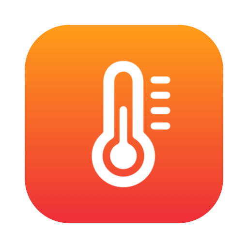
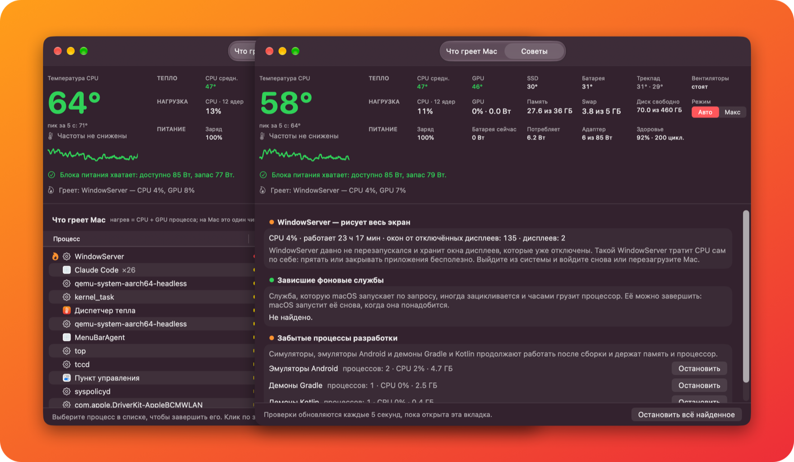
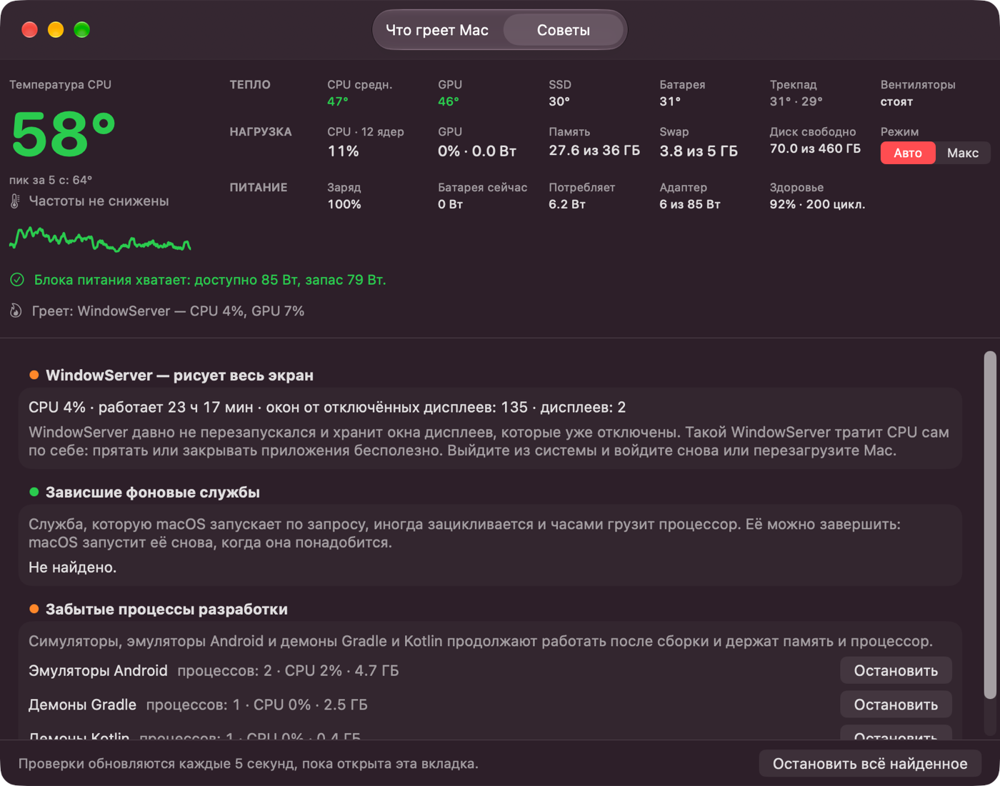
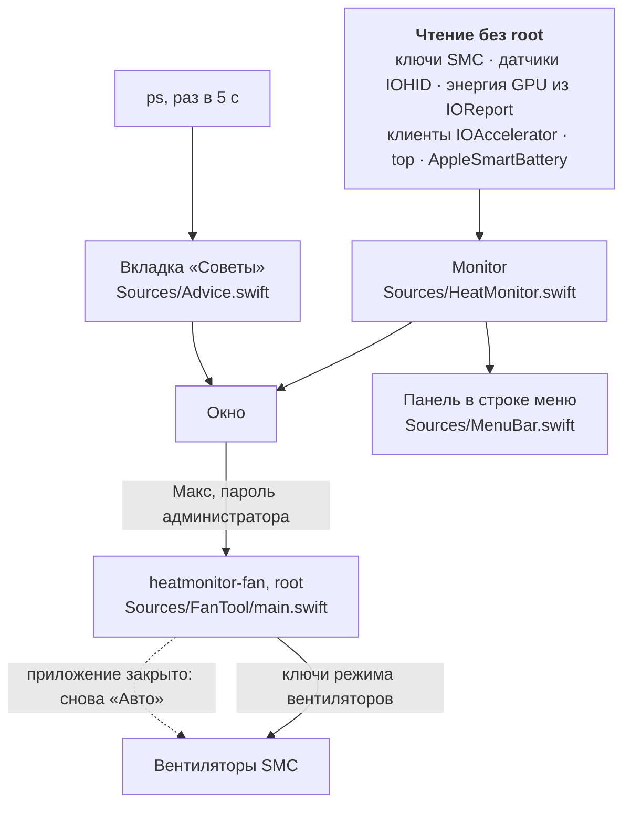

<div align="center">
  
  <h1>Heat Monitor</h1>
  <p><b>Приложение в строке меню macOS: насколько горячий Mac и что его греет.</b></p>
  <p><a href="README.md">English</a> · Русский</p>

  <a href="https://github.com/Disspear574/HeatMonitor/releases/latest/download/HeatMonitor.dmg">
    
  </a>
  <br><br>
  <a href="https://github.com/Disspear574/HeatMonitor/releases/latest"></a>
  
  
  
  <a href="LICENSE"></a>
</div>

<br>

<p align="center">
  
</p>

Нажмите термометр в строке меню, посмотрите, кликните мимо. Heat Monitor читает датчики, только
пока вы смотрите, в сеть не ходит, а для чтения датчиков пароль администратора не нужен.

## Возможности

- **Строка меню.** Термометр открывает компактную панель: температура CPU с графиком, датчики,
  нагрузка, память и своп, питание, пять самых горячих приложений и вентиляторы. Подробнее — в
  разделе [Строка меню](#строка-меню).
- **Температура CPU.** Самое горячее ядро, среднее за 5 секунд, пик за 5 секунд и график за
  3 минуты.
- **Датчики.** Среднее по ядрам CPU, GPU, SSD, батарея, трекпад и обороты вентиляторов.
- **Что греет Mac.** Приложения или отдельные процессы по нагреву: их доля CPU плюс GPU.
  Правый клик по строке — поиск в интернете, показ в Finder или завершение.
- **Питание.** Заряд, ток батареи, потребление Mac и мощность от адаптера против той, что он
  может дать. Одна строка говорит, хватает ли блока питания или батарея садится на зарядке.
- **Вентиляторы.** Переключатель «Авто / Макс». Подробнее — в разделе
  [Вентиляторы](#вентиляторы).
- **Советы.** Находит WindowServer, который несколько дней не перезапускался, зациклившиеся
  фоновые службы и забытые после сборки симуляторы, эмуляторы и демоны Gradle.
- **Все датчики.** Полный список температурных датчиков и кнопка «Скопировать всё».
- **Русский и английский.** Язык интерфейса — как у системы.

<details>
<summary>Скриншоты в полный размер</summary>
<br>


</details>

## Строка меню

Heat Monitor запускается в строке меню, без окна и без значка в Dock. Левый клик открывает
панель, правый — меню «Открыть Диспетчер тепла» и «Выйти». Закрытое окно приложение не завершает.

Настройки (шестерёнка в панели или ⌘,):

| Настройка | Варианты | По умолчанию |
|---|---|---|
| Показывать в Dock | вкл., выкл. | выкл. |
| Строка меню | Только значок, Значок и значения | Только значок |
| Значения | Температура CPU, температура GPU, обороты вентиляторов, потребление Mac, загрузка CPU | Температура CPU |
| Панель | Температура и график, датчики, нагрузка, питание, что греет Mac, вентиляторы | все включены |

## Установка

1. Скачайте [HeatMonitor.dmg](https://github.com/Disspear574/HeatMonitor/releases/latest/download/HeatMonitor.dmg).
2. Откройте его и перетащите **Heat Monitor** в **Программы**.

> [!IMPORTANT]
> Приложение подписано ad hoc и не нотаризовано Apple, поэтому macOS блокирует первый запуск.
> Откройте **Системные настройки → Конфиденциальность и безопасность**, найдите сообщение о
> Heat Monitor и нажмите **Всё равно открыть**. Или снимите карантин в Терминале:
>
> ```bash
> xattr -dr com.apple.quarantine /Applications/HeatMonitor.app
> ```

**Требования:** Mac на Apple Silicon (M1 и новее) и macOS 14 или новее. Mac на Intel не
поддерживаются.

## Вентиляторы

Переключатель **Авто / Макс** — единственное, что приложение меняет в Mac.

- **Макс** спрашивает пароль администратора. Затем встроенная утилита `heatmonitor-fan`
  выставляет всем вентиляторам максимальные обороты через SMC.
- Рядом остаётся небольшой сторож с правами root. Он возвращает «Авто», когда Heat Monitor
  закрывается, даже после сбоя.
- Закрытое окно приложение не завершает, поэтому вентиляторы остаются на «Макс», пока вы не
  выберете «Выйти».
- **Авто** просит сторожа вернуть вентиляторы macOS, поэтому пароль не нужен. Пароль
  спрашивается, только если ручной режим включила другая программа для вентиляторов.

Приложение никогда не опускает обороты ниже тех, что просит macOS. На Mac без вентиляторов
переключателя нет.

## Советы

Вкладка проверяет систему каждые 5 секунд и только пока она открыта.

| Проверка | Что ищет | Что можно сделать |
|---|---|---|
| WindowServer | Высокая нагрузка, дни без перезапуска, невидимые окна от отключённых дисплеев | Выйти из системы и войти снова или перезагрузить Mac |
| Зависшие службы | Фоновые службы macOS, которые часами грузят процессор | Завершить свои; системные только показаны |
| Забытые процессы разработки | Симуляторы iOS, эмуляторы Android, демоны Gradle и Kotlin | Остановить группу или всё найденное после подтверждения |

## Как это работает



| Показание | Источник |
|---|---|
| Температура CPU и GPU | Ключи SMC `Tp*`, `Te*` (ядра CPU) и `Tg*` (GPU) |
| Температура SSD и батареи | Температурные датчики IOHID |
| Потребление Mac, мощность адаптера | Ключи SMC `PSTR` и `PDTR` |
| Ватты GPU | IOReport «Energy Model», канал `GPU Energy` (его же читает `powermetrics`) |
| Загрузка GPU | `IOAccelerator` → `PerformanceStatistics` |
| GPU по процессам | Время GPU каждого клиента `IOAccelerator` |
| Процессы | Один долгоживущий `top` |
| Батарея и адаптер | `AppleSmartBattery` и источники питания IOKit |
| Советы | `ps`, пока открыта вкладка; невидимые окна из `CGWindowListCopyWindowInfo` |

Часть этих интерфейсов — закрытые интерфейсы macOS, поэтому продавать приложение в Mac App Store
нельзя.

## Полезно знать

- Датчики ядер реагируют за доли секунды. Короткий всплеск нагрузки поднимает ядро на 20 °C,
  особенно на MacBook Air без вентилятора. Поэтому крупная цифра — среднее за 5 секунд.
- Загрузка GPU — доля времени, когда у GPU есть работа, а не доля его мощности. На самой низкой
  частоте даже лёгкая работа даёт 20–40 %; реальную нагрузку показывают ватты.
- Датчики трекпада (`Ts0P`, `Ts1P`) далеко от чипа. На MacBook Air они почти комнатной
  температуры, когда область над клавиатурой горячая.
- Мощность адаптера — та, о которой договорились Mac и адаптер, а не цифра на корпусе блока.
  Через MagSafe она бывает меньше паспортной.
- Heat Monitor опрашивает процессы и датчики, только пока открыта панель или окно, и ещё 60 секунд
  после закрытия. В остальное время процессор не тратится. Живая подпись читает несколько ключей
  SMC раз в 5 секунд — около 0,1 % одного ядра.

## Сборка

```bash
./scripts/build.sh      # build/HeatMonitor.app
./scripts/make-dmg.sh   # build/HeatMonitor.dmg
./scripts/test.sh       # тесты логики строки меню
```

Нужны Xcode Command Line Tools. Версия задаётся в `Resources/Info.plist`.

| Путь | Что это |
|---|---|
| `Sources/HeatMonitor.swift` | Окно и все показания |
| `Sources/MenuBar.swift` | Значок в строке меню и его панель |
| `Sources/Settings.swift` | Настройки |
| `Sources/MenuLogic.swift` | Значения подписи и правила опроса; тесты в `Tests/` |
| `Sources/Advice.swift` | Вкладка «Советы» |
| `Sources/FanTool/main.swift` | Переключатель вентиляторов, работает только от root |
| `Resources/` | Info.plist, иконка, строки `en.lproj` и `ru.lproj` |
| `scripts/` | Сборка, DMG, генераторы иконки и картинок для README |

## Лицензия

[MIT](LICENSE)
